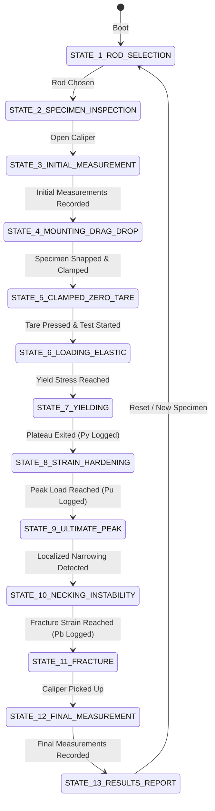

# System Architecture Specification

## 3D Virtual Universal Testing Machine (UTM) Simulation

---

## 1. Executive Summary

This architecture document defines the software structure, subsystem boundaries, data flow pipelines, 3D scene graph, and state management for the interactive **Virtual Universal Testing Machine (UTM) Tensile Test Simulation**.

The application is structured around a **decoupled, event-driven architecture**: the mechanical engineering physics solver computes material responses in real-time, which drives procedural mesh deformations in the **Three.js** 3D scene while streaming telemetry to an industrial heads-up display (HUD).

```
                      ┌────────────────────────┐
                      │    User Interactions   │
                      │  (Mouse / Touch / Keys)│
                      └───────────┬────────────┘
                                  │
                                  ▼
                      ┌────────────────────────┐
                      │      EventBus          │
                      └─────┬───────────┬──────┘
                            │           │
            ┌───────────────▼┐         ┌▼────────────────┐
            │  StateMachine  │         │ InteractionRig  │
            │  (13 States)   │         │ (Raycasting/D&D)│
            └───────┬────────┘         └────────┬────────┘
                    │                           │
                    ▼                           ▼
        ┌─────────────────────────┐   ┌──────────────────┐
        │  Mechanical Physics     │   │   Three.js       │
        │  Constitutive Engine    │──▶│   Scene Graph    │
        └───────────┬─────────────┘   └─────────┬────────┘
                    │                           │
                    ▼                           ▼
        ┌─────────────────────────┐   ┌──────────────────┐
        │   Live Telemetry HUD    │   │  WebGL2 Canvas   │
        │   & Real-time Charts    │   │  (60 FPS Render) │
        └─────────────────────────┘   └──────────────────┘
```

---

## 2. Directory & Module Boundaries

```
tensile-test-simulation/
├── docs/                                  # Engineering & Architectural Specifications
│   ├── ARCHITECTURE.md                    # This document
│   ├── DESIGN.md                          # UI/UX, Design Tokens & Aesthetics
│   ├── PRINCIPLES.md                      # Mechanical Physics & Metrology Theory
│   └── LAB_PROCEDURE.md                   # Experimental Protocol & Lab Manual
├── public/
│   ├── favicon.svg                        # Machine silhouette favicon
│   ├── textures/                          # Brushed metallic maps, knurling textures
│   └── sounds/                            # Mechanical SFX (hum, clamp, fracture)
├── src/
│   ├── core/                              # Orchestration & State Management
│   │   ├── EventBus.js                    # Lightweight Pub/Sub event dispatcher
│   │   ├── StateMachine.js                # 13-stage lab experiment state engine
│   │   └── App.js                         # Application coordinator & lifecycle
│   ├── physics/                           # Mechanical Engineering Solvers
│   │   ├── MaterialConstants.js           # Physical constants for Mild Steel (E, σy, σu, εf)
│   │   ├── TensileEngine.js               # Continuous stress-strain mathematical solver
│   │   └── LabCalculator.js               # Post-test report metrics (A0, Af, %El, %RA, E)
│   ├── three/                             # 3D Graphics Subsystem
│   │   ├── SceneManager.js                # Three.js scene, renderer, shadow maps, camera rig
│   │   ├── Environment.js                 # Lab room, workbench, safety perimeter, ambient light
│   │   ├── apparatus/
│   │   │   ├── UTMFrame.js                # Base plate, steel load columns, moving crosshead
│   │   │   ├── ClampingGrips.js           # Upper & lower hydraulic wedge grips with clamping animation
│   │   │   └── MachineConsole.js          # Physical digital readouts mounted directly on the UTM
│   │   ├── specimen/
│   │   │   ├── SpecimenModel.js           # Parametric cylindrical rod (8, 10, 12 mm) with gauge lines
│   │   │   ├── NeckingDeformation.js      # Procedural vertex shader & necking profile generator
│   │   │   └── FracturePieces.js          # Broken specimen halves with cup-and-cone morphology
│   │   ├── metrology/
│   │   │   ├── VernierCaliper.js          # 3D Caliper with movable slider, jaws, & metric scales
│   │   │   └── CaliperRaycaster.js        # Contact detection between caliper jaws and specimen
│   │   └── interaction/
│   │       ├── DragDropMount.js           # Bench-to-UTM drag physics, snap bounds, clamping trigger
│   │       └── OrbitControlsManager.js    # Camera preset views (Overview, Grip Zone, Caliper Bench)
│   ├── ui/                                # User Interface & HUD
│   │   ├── HUDController.js               # State-driven UI synchronizer
│   │   ├── components/
│   │   │   ├── SpecimenSelector.js        # 3D cards for 8 mm, 10 mm, 12 mm rods + UTM specs
│   │   │   ├── TelemetryReadouts.js       # High-contrast digital LED readouts (kN, mm, MPa, ε)
│   │   │   ├── RealtimeCharts.js          # Dual 60fps graphs (Load-Elongation & Stress-Strain)
│   │   │   ├── CaliperHUD.js              # High-magnification optical lens for Vernier reading
│   │   │   ├── IndustrialControlBar.js    # Tactile industrial controls (Start, Tare, Reset, E-Stop)
│   │   │   ├── ModeSwitch.js              # Guided Mode vs Assessment Mode selector
│   │   │   └── LabReportModal.js          # Final tabulated results, graphs, and print exporter
│   ├── styles/
│   │   ├── tokens.css                     # CSS variables (colors, typography, elevation)
│   │   ├── main.css                       # Layout grid & canvas framing
│   │   ├── hud.css                        # Glassmorphic telemetry panels & cards
│   │   ├── controls.css                   # Industrial buttons, LEDs, and E-Stop switch
│   │   └── report.css                     # Printable lab report formatting
│   └── main.js                            # Application entry point
├── index.html                             # Semantic HTML markup shell
├── package.json
└── vite.config.js
```

---

## 3. Finite State Machine (FSM)

The laboratory workflow is strictly partitioned into **13 discrete states**. State transitions are validated by preconditions (e.g., crosshead loading cannot start if the grips are not clamped and zeroed).



### State Definitions & Enforced Constraints

| # | State Name | Permitted User Actions | Transition Condition |
|---|---|---|---|
| **1** | `ROD_SELECTION` | Click 8 mm / 10 mm / 12 mm rod cards | Rod card selected. |
| **2** | `SPECIMEN_INSPECTION` | Orbit around rod; inspect nominal specs | User activates caliper or clicks "Begin Metrology". |
| **3** | `INITIAL_MEASUREMENT` | Drag caliper, slide jaws around diameter & gauge marks | "Record Measurement" button clicked for both $d_0$ and $L_0$. |
| **4** | `MOUNTING_DRAG_DROP` | Drag specimen across 3D space toward UTM grips | Specimen dropped within snap boundary ($\Delta r < 15\text{ mm}$, $\Delta \theta < 5^\circ$). |
| **5** | `CLAMPED_ZERO_TARE` | Click "Tare / Zero Load" button | Tare command executed; load cell and displacement zeroed. |
| **6** | `LOADING_ELASTIC` | Observe machine; Emergency Stop active | Load reaches Upper Yield Point ($P_{y,upper}$). |
| **7** | `YIELDING` | Observe yield oscillations; Emergency Stop active | Lüders strain completed; strain hardening commences ($P_y$ logged). |
| **8** | `STRAIN_HARDENING` | Observe crosshead displacement; Emergency Stop active | Maximum tensile load achieved ($P_u$ logged). |
| **9** | `ULTIMATE_PEAK` | Observe peak load; Emergency Stop active | Cross-sectional necking instability initiates ($d\sigma/d\varepsilon = \sigma$). |
| **10** | `NECKING_INSTABILITY` | Observe localized diameter reduction | True failure strain reached; stress drops precipitously. |
| **11** | `FRACTURE` | Observe audible/visual cup-and-cone break ($P_b$ logged) | Halves disengage and settle onto lower grip / safety catch. |
| **12** | `FINAL_MEASUREMENT` | Drag caliper to measure fractured gauge length $L_f$ & neck diameter $D_n$ | Both post-test measurements recorded via HUD. |
| **13** | `RESULTS_REPORT` | View graphs, export lab report, click "Retest / Reset" | User clicks reset or switches to Assessment Mode. |

---

## 4. 3D Scene Graph & Visual Pipeline

### Scene Graph Topology

```
Three.Scene
├── AmbientLight (Soft laboratory fill light, intensity 0.6)
├── DirectionalLight (Key studio light with crisp contact shadows, intensity 1.2)
├── DirectionalLight (Rim/specular light for metallic highlights, intensity 0.8)
├── EnvironmentGroup (Workbench, non-slip floor grid, lab safety rail)
│   ├── BenchMesh (Dark matte industrial laminate)
│   └── CalibrationStandMesh
├── UTMGroup (World position: [0, 0, 0])
│   ├── BasePlateMesh (Heavy cast iron texture)
│   ├── LeadScrewLeftMesh & LeadScrewRightMesh (Threaded steel)
│   ├── GuideColumns (Polished chrome cylinders)
│   ├── LowerGripAssembly (Fixed at base, animated jaw wedges)
│   ├── MovingCrossheadAssembly (Kinematic Y-axis translation)
│   │   ├── CrossheadHousingMesh
│   │   ├── LoadCellSensorMesh
│   │   └── UpperGripAssembly (Animated jaw wedges)
│   └── ControlConsoleMesh (Hardware E-Stop button, digital display LED)
├── SpecimenGroup (Positioned on Bench initially, snaps to UTM)
│   ├── UnfracturedMesh (Parametric cylinder with gauge grooves)
│   ├── UpperFracturedHalf (Active post-fracture, cone profile)
│   └── LowerFracturedHalf (Active post-fracture, cup profile)
└── MetrologyGroup
    └── VernierCaliperMesh (World movable)
        ├── MainBeamMesh (Engraved 1 mm tick marks)
        ├── FixedJawMesh
        ├── SlidingVernierMesh (Animated along X-axis, 0.02 mm scale)
        └── DepthProbeMesh
```

### Procedural Specimen Necking Shader / Vertex Deformer

To provide hyper-realistic physical deformation rather than static scaling:
1. The gauge length cylinder is subdivided into 64 axial rings along its $Y$-axis.
2. In the **Elastic and Uniform Plastic** phases:
   $$\Delta L = \varepsilon \cdot L_0$$
   $$r(y) = r_0 \cdot \sqrt{\frac{L_0}{L_0 + \Delta L}} \quad (\text{Isochoric volume conservation})$$
3. In the **Necking Phase**:
   A Gaussian necking contraction is superimposed at the failure locus $y_c$:
   $$r(y) = r_{\text{uniform}} - \Delta r_{\text{neck}} \cdot \exp\left(-\frac{(y - y_c)^2}{2\sigma_{\text{neck}}^2}\right)$$
4. At **Fracture**:
   The mesh geometry splits into two distinct meshes with matching cup-and-cone internal shear lips at $45^\circ$.

---

## 5. Drag-and-Drop Snap System

The drag-and-drop mechanism uses **Three.js Raycasting** projected onto a virtual camera-aligned interaction plane:

1. **Grab**: Mouse click on specimen checks distance to cursor. Specimen lifts slightly ($+10\text{ mm}$ on $Z$-axis) and casts a dynamic drop shadow.
2. **Track**: Pointer move projects ray onto the mounting plane spanning between the workbench and the UTM center.
3. **Snap Target Zone**: A bounding cylinder at the UTM grip center ($x \in [-15, 15]\text{ mm}$, $z \in [-15, 15]\text{ mm}$) turns from subtle white outline to vibrant cyan/green when the specimen enters the zone.
4. **Drop**:
   - If released within the snap threshold: Specimen smoothly interpolates (lerp) into exact concentric alignment with upper and lower grip axes.
   - The StateMachine transitions to `CLAMPED_ZERO_TARE`.
   - The hydraulic clamping jaws animate inward along the $X$-axis with an audible metallic clamping sound.
   - If released outside: The specimen falls back to the nearest workbench rest position.

---

## 6. Metrology Subsystem (Vernier Caliper)

The 3D Vernier caliper replicates actual mechanical measurement:
- **Kinematic Constraints**: The movable jaw is constrained to slide along the main beam axis ($X$-axis) between $0.00\text{ mm}$ and $150.00\text{ mm}$.
- **Contact Raycasting**: When the user drags the movable jaw toward the specimen, rays cast from the inside jaw face detect the outer boundary of the rod.
- **Dynamic Measurement Formula**:
  $$\text{Reading} = (\text{Main Scale Integer}) + (\text{Coinciding Vernier Division} \times 0.02\text{ mm}) + \delta_{\text{human}}$$
  Where $\delta_{\text{human}}$ is a natural alignment tolerance ($\pm 0.02\text{ to } 0.08\text{ mm}$) depending on how squarely the caliper was positioned against the specimen axis.
- **Magnified HUD Loupe**: An interactive high-magnification overlay displays the exact main scale tick alignment against the vernier slider division to teach students how to read a physical vernier scale.

---

## 7. Event-Driven Communication Matrix

All modules communicate via `EventBus.js` to ensure zero direct coupling between physics, graphics, and HUD overlays:

| Event Name | Source | Payload | Primary Listeners |
|---|---|---|---|
| `ROD_SELECTED` | SpecimenSelector | `{ rodId, d0, L0, material, matchedUTM }` | StateMachine, UTMApparatus, SpecimenModel |
| `CALIPER_MOVED` | VernierCaliper | `{ jawGap, contactDetected, currentReading }` | CaliperHUD, MetrologyManager |
| `MEASUREMENT_RECORDED`| CaliperHUD | `{ type: 'd0'|'L0'|'Dn'|'Lf', value }` | StateMachine, LabCalculator, HUDController |
| `SPECIMEN_MOUNTED` | DragDropMount | `{ success: boolean, alignmentError }` | StateMachine, ClampingGrips, SoundManager |
| `MACHINE_TARED` | ControlBar | `{ timestamp }` | TensileEngine, StateMachine, TelemetryPanel |
| `TEST_STARTED` | ControlBar | `{ crossheadSpeed: mm_per_min }` | StateMachine, TensileEngine, UTMFrame |
| `PHYSICS_TICK` | TensileEngine | `{ load_kN, elongation_mm, stress_MPa, strain }` | TelemetryReadouts, RealtimeCharts, SpecimenModel, MachineConsole |
| `STAGE_CHANGED` | TensileEngine | `{ stage: 'elastic'|'yield'|'hardening'|'necking'|'fracture', load, elongation }` | StateMachine, HUDController, SoundManager |
| `EMERGENCY_STOP` | ControlBar / Console | `{ reason: string }` | TensileEngine, UTMFrame, StateMachine |
| `TEST_COMPLETED` | StateMachine | `{ fullDataset, calculatedResults }` | LabReportModal, RealtimeCharts |

---

## 8. Telemetry & Charting Data Flow

1. **Physics Tick (60 Hz)**: The `TensileEngine` advances crosshead displacement by $\Delta y = v_{\text{crosshead}} \cdot \Delta t$.
2. It evaluates instantaneous engineering stress $\sigma$ and instantaneous load $P = \sigma \cdot A_0$.
3. Emits `PHYSICS_TICK` with `{ load_kN, elongation_mm, stress_MPa, strain }`.
4. `TelemetryReadouts.js` formats the values into high-contrast digital displays.
5. `RealtimeCharts.js` pushes the coordinate pairs into two lightweight Canvas buffers:
   - **Buffer 1**: $[ \Delta L \text{ (mm)}, P \text{ (kN)} ]$
   - **Buffer 2**: $[ \varepsilon \text{ (mm/mm)}, \sigma \text{ (MPa)} ]$
6. Curves render smoothly with active point tracers, automatic axis rescaling, and highlighted landmark dots for Yield Point ($P_y$), Ultimate Load ($P_u$), and Fracture ($P_b$).

---

## 9. Performance & Rendering Budgets

| Metric | Target Budget | Optimization Strategy |
|---|---|---|
| **Frame Rate** | Constant 60 FPS | Low polygon count for static frame (~15k polys), shared PBR materials, instanced fasteners. |
| **Draw Calls** | $< 35$ per frame | Merged static frame geometries; dynamic meshes isolated to moving crosshead, grips, specimen, and caliper. |
| **Initial Bundle Size** | $< 1.2\text{ MB}$ compressed | Procedural geometry generation where possible; SVGs for UI icons; lightweight Canvas plotting. |
| **Memory Footprint** | $< 120\text{ MB}$ heap | Geometry buffer pooling; circular array for telemetry chart samples. |
| **Mobile / Trackpad** | Full touch & gesture support | PointerEvents API with unified mouse/touch coordinate mapping. |
